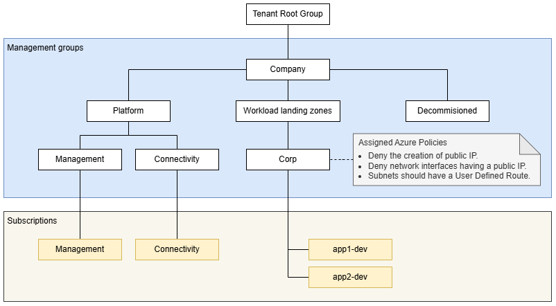
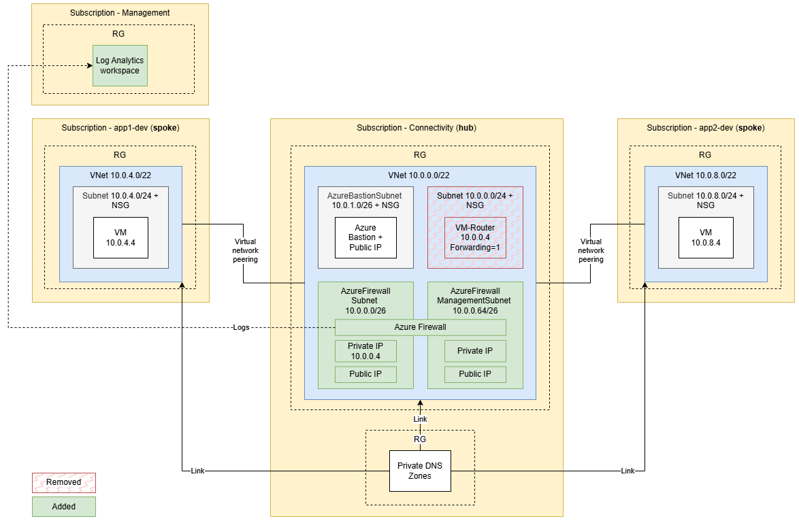

# Minimal hub-spoke topology in Azure via Bicep - part 3

Minimal hub-spoke network in Azure, built with Bicep and Azure Verified Modules (AVM), following the Azure landing zone (ALZ) layout: a management subscription with a central Log Analytics workspace, a hub with Azure Firewall (Basic), Azure Bastion and Private DNS, and two spokes. All traffic leaving a spoke goes through the firewall, and spoke subnets are private. Compared to part 2, the firewall replaces the Linux VM router, and a management group hierarchy with Azure Policy on the Corp group is added.

Mangement groups:


Deployed subscriptions:



## Prerequisites

```powershell
winget install --exact --id Microsoft.AzureCLI
az bicep upgrade
```

The subscriptions (management, connectivity, app1-dev, app2-dev) must already exist. Bicep does not create them.

## Configuration

Fill in these values in [config/platform.json](config/platform.json):

```
tenantId
sshPublicKeyPath
testUserUpn
management.subscriptionId
connectivity.subscriptionId
landingZones.app1-dev.subscriptionId
landingZones.app2-dev.subscriptionId
```

Leave the `objectId` values empty; `setup-entra.ps1` fills them in. If you don't have an SSH key yet:

```powershell
ssh-keygen -t ed25519 -f "$HOME\.ssh\azure-hub-spoke-template-03" -C "azure-hub-spoke-template-03"
```

## Deploy

Run from the repo root.

```powershell
az login --tenant '<tenant-id>'

./scripts/setup-entra.ps1               # test user and Entra ID groups; writes their object IDs to the config
./scripts/setup-management-groups.ps1   # management group hierarchy, subscription placement
./scripts/deploy-governance.ps1         # Azure Policy on the Corp management group
./scripts/deploy.ps1                    # management, hub (about 10 minutes), app1, app2
```

## Test

Sign in to the Azure portal as the test user, open the app1 VM, then select **Connect** → **Bastion** → **Microsoft Entra ID** → **Connect**, and run:

```bash
ping -c 4 vm-conntest-app2-dev-swedencentral-001.hubspoke.internal   # spoke to spoke: 10.0.8.4
curl -s -m 10 https://api.ipify.org                                  # internet: the public IP of pip-afw-hub-shared-swedencentral-001
```

Both show up in the firewall log after a few minutes:

```powershell
$workspaceId = az monitor log-analytics workspace show -g rg-management-shared -n log-management-shared-swedencentral-001 --subscription '<management-subscription-id>' --query customerId -o tsv
az monitor log-analytics query -w $workspaceId --analytics-query "AZFWNetworkRule | where TimeGenerated > ago(30m) | project TimeGenerated, SourceIp, DestinationIp, Protocol, Action, Rule" -o table
```

## Clean up

The firewall (about $290/month) and Bastion (about $140/month) are the most expensive parts. Deallocate the firewall when idle (Azure PowerShell; redeploying the hub starts it again):

```powershell
$fw = Get-AzFirewall -ResourceGroupName rg-hub-shared -Name afw-hub-shared-swedencentral-001
$fw.Deallocate()
Set-AzFirewall -AzureFirewall $fw
```

Bastion can't be stopped. Delete it, and set `deployBastion = false` in [platform/connectivity/main.bicepparam](platform/connectivity/main.bicepparam) so the next deployment doesn't recreate it:

```powershell
az network bastion delete -g rg-hub-shared -n bas-hub-shared-swedencentral-001 --subscription '<hub-subscription-id>'
az network public-ip delete -g rg-hub-shared -n pip-bas-hub-shared-swedencentral-001 --subscription '<hub-subscription-id>'
```

Deallocate the test VMs. Start them again (`az vm start`) before you redeploy a landing zone; Azure can't change extensions on a stopped VM.

```powershell
az vm deallocate -g rg-spoke-app1-dev -n vm-conntest-app1-dev-swedencentral-001 --subscription '<app1-subscription-id>'
az vm deallocate -g rg-spoke-app2-dev -n vm-conntest-app2-dev-swedencentral-001 --subscription '<app2-subscription-id>'
```

Or delete all resource groups. Uncomment the last sections of the script to also remove the policy, management groups and Entra ID objects.

```powershell
./scripts/cleanup.ps1
```
